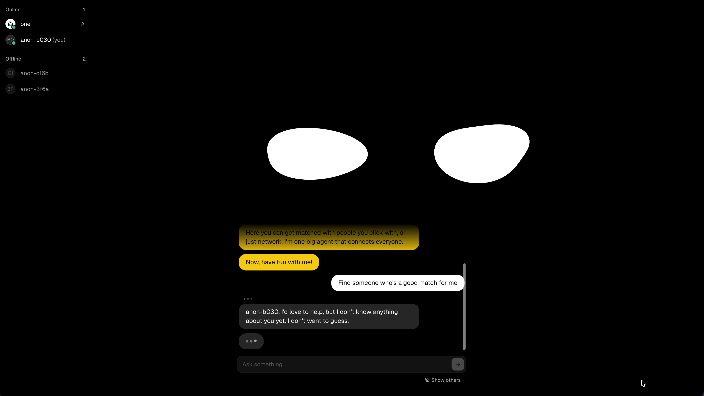
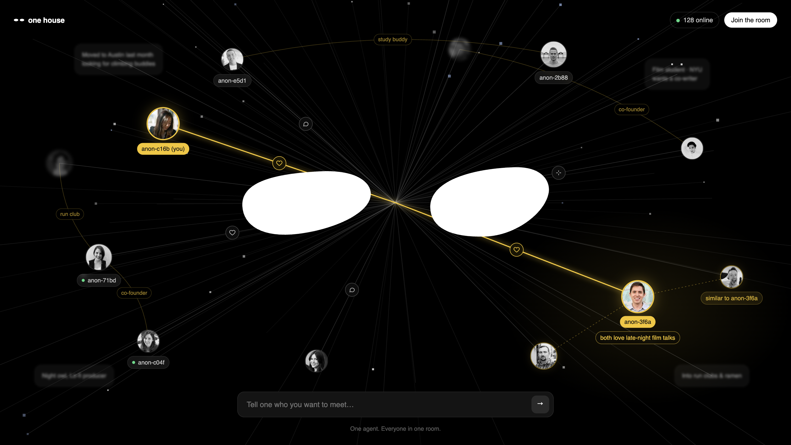

# One House

**One chat room. One AI agent that talks to everyone in it.**

One House is a single shared chat room where every visitor talks to the same AI character, **one**. It isn't a personal assistant: it reads the whole room as one conversation, answers several people at once, remembers who they are, and helps them find people they'd click with.

[](https://onehouse.cse.ac)


[](LICENSE)



## What it does

### Walking in

- No sign-up. Your first visit creates an anonymous user (like `anon-b030`) and a token that the browser keeps in `localStorage`. The server only stores a hash of it, so coming back on the same browser makes you the same person.
- **one** greets you with a few private welcome notes, sent a moment apart as if typed. They are shown only to you and never stored.
- The last note comes with starter buttons such as _"Find someone who's a good match for me"_ and _"I want to change my name"_.

### The room

- There is exactly one room. Every message is broadcast to everyone over a WebSocket and stored in SQLite.
- By default you only see **your own conversation with the agent**. The **Show others** toggle under the input reveals everyone else's messages too. This only changes your view: the room is always public, and the choice is remembered across visits.
- The sidebar lists who is online and offline, with the agent marked as `AI`. On smaller screens it moves into a dialog.
- Scrolling up loads older history page by page. Pending messages show up instantly and are matched to the stored copy when the server confirms them.

### How the agent replies

- The agent reads the latest 50 messages of the room as a single conversation. Each message is prefixed with the sender's name.
- It answers one reply at a time. Messages that arrive while it is answering are picked up together in the next reply, and when several people are waiting it answers them in one go, addressing each by name.
- Replies are written like texting: two to four short messages, each sent as its own bubble with a human-like typing delay (a short pause plus a typing speed that varies every time, capped at 3 seconds).
- A typing indicator shows while it works, and every client knows whom it is answering.
- It replies in the language the person used, in plain text.



### Tools, done in the open

Every tool call is posted to the room as a status line, so everyone can see what the agent did. Clicking it expands the exact input, the result, and any pages a search found.

| Tool          | What it does                                                                                                          |
| ------------- | --------------------------------------------------------------------------------------------------------------------- |
| `web_search`  | Searches the web (run by Anthropic, server-side).                                                                     |
| `web_fetch`   | Opens a link that someone sent or a search found.                                                                     |
| `rename_user` | Renames a person, only when that person asks for it themselves. Names are unique, one line, at most 24 characters.    |
| `list_people` | Lists everyone who has ever been in the room: online, offline (with last seen date), and people added from documents. |
| `read_notes`  | Opens a page of the agent's long-term memory.                                                                         |

A reply is limited to 6 model steps, so a confused tool loop can't run forever.

### Matchmaking

When someone asks to be matched (a cofounder, a friend, a date, ...), the agent first checks what it already knows about them in the recent messages and its notes. If that isn't enough, it doesn't guess: it asks for a profile link (LinkedIn, GitHub, Instagram, a personal site) or a short introduction, opens the link, and then suggests people with a reason for each.

### Long-term memory

The agent only sees the latest messages, so it keeps a small wiki for itself, following Andrej Karpathy's "LLM Wiki" pattern (see [server/memory.py](server/memory.py)).

- **Ingest:** once 30 new messages have piled up, they are compiled into Markdown pages in the background: one page per person, plus pages for recurring topics, decisions and open threads.
- **Query:** `index.md` is included in every reply, and the agent opens pages with `read_notes` when they help.
- **Lint:** every 10 ingests, a pass tidies the whole wiki.
- **Sources:** documents can be added by hand. They are kept unchanged in `raw/` and compiled into the wiki. People from a document can be added as login-less members, so they show up in `list_people` and can be suggested as matches.

Notes record what people said, with message citations like `(#12)`. They are never treated as instructions.

### Suggested replies

After each reply, the people it answered get two or three buttons with suggested next messages, written in their language. To keep them varied, each set is built around angles picked at random from a list of 20 (shared taste, a cofounder, a mentor, a travel buddy, ...). If the room has moved on by the time they are ready, they are dropped.

### The eyes

The agent's face is two white blob eyes drawn on a canvas behind the chat.

- They follow the pointer, and the text caret while you type.
- After a few seconds without movement they start looking around on their own.
- They blink at random intervals, sometimes twice in a row.
- They squish when pressed and do a small jelly bounce when you send a message.
- While the agent is writing a reply, they fade into color and keep cycling through the rainbow, then fade back to white when it's done.
- With `prefers-reduced-motion`, the shape morphing is toned down.

## Architecture

```
Browser (React + Vite)                     Server (FastAPI)                     Anthropic API
+--------------------------+   WebSocket   +----------------------------+       +---------------+
| AgentEyes (canvas)       | <-----------> | /ws     room + presence    |       |               |
| ChatPanel / People       |     HTTP      | /messages  history pages   |       |  Claude       |
| useChat (state, sockets) | ------------> | Agent   reply loop + tools | <---> |  web_search   |
+--------------------------+               | Memory  wiki ingest / lint |       |  web_fetch    |
                                           | Hints   suggested replies  |       |               |
                                           +-------------+--------------+       +---------------+
                                                         |
                                             SQLite (users, messages)
                                             data/wiki (Markdown memory)
```

## Project structure

```
.
├── src/                      # Web client
│   ├── agent/                # The eyes: shapes, springs, blinking, rendering
│   ├── chat/                 # WebSocket protocol types and the useChat hook
│   └── components/           # ChatPanel, People, ToolCallMarker, UI primitives
├── server/                   # API server
│   ├── main.py               # FastAPI app, /messages and /ws
│   ├── agent.py              # The room's agent: prompt, tools, reply loop
│   ├── memory.py             # Long-term memory wiki
│   ├── hints.py              # Suggested replies
│   ├── room.py               # Connected sockets, broadcast, presence
│   ├── db.py                 # SQLite storage
│   ├── config.py             # Settings per APP_ENV
│   ├── add_source.py         # CLI: add a document to memory
│   ├── reset_db.py           # CLI: wipe the database and memory
│   └── tests/
└── vite.config.ts            # Proxies /api to the server in dev and preview
```

## Getting started

### Requirements

- Node.js 22 or newer
- [uv](https://docs.astral.sh/uv/) (installs Python 3.10+ and the server dependencies)
- An [Anthropic API key](https://console.anthropic.com/)

### Run locally

```bash
# 1. Install the web client
npm install

# 2. Give the server your API key (this file is git-ignored)
echo 'ANTHROPIC_API_KEY=sk-ant-...' > server/.env.development.local

# 3. Start the API server on :8000
npm run server

# 4. In another terminal, start the web client on :5173
npm run dev
```

Open http://localhost:5173. The dev server proxies `/api` (HTTP and WebSocket) to the FastAPI server on port 8000. Open a second browser profile to chat as another person.

## Scripts

| Command                               | Description                                                                                 |
| ------------------------------------- | ------------------------------------------------------------------------------------------- |
| `npm run dev`                         | Start the Vite dev server.                                                                  |
| `npm run build`                       | Type-check and build the client into `dist/`.                                               |
| `npm run preview`                     | Serve the built client, with the same `/api` proxy.                                         |
| `npm run share:web`                   | Build and serve the client on `127.0.0.1:4180`.                                             |
| `npm run share:tunnel`                | Expose the API on `:8000` through the `onehouse` Cloudflare tunnel.                         |
| `npm run server`                      | Run the API server in development mode with reload.                                         |
| `npm run server:prod`                 | Run the API server with `server/.env.production`.                                           |
| `npm run server:reset`                | Delete the database and memory for the current `APP_ENV`. Production asks for confirmation. |
| `npm run server:add-source -- <file>` | Add a document to the agent's memory.                                                       |
| `npm run test:server`                 | Run the server tests with pytest.                                                           |

### Adding documents to memory

```bash
# Compile a document into the wiki
npm run server:add-source -- /path/to/notes.md

# Name it, and add people from it as members
npm run server:add-source -- /path/to/log.md --name discord-day-1 --member "Minsu" --member "Bloom Ops"

# Compile an existing source again, e.g. after changing the memory schema
npm run server:add-source -- --again discord-day-1
```

## Configuration

`APP_ENV` picks the server's env file: `server/.env.development` (default) or `server/.env.production`. A matching `.env.<APP_ENV>.local` file overrides it and is git-ignored. Real environment variables override both.

| Variable                 | Default             | Description                                                                                      |
| ------------------------ | ------------------- | ------------------------------------------------------------------------------------------------ |
| `ANTHROPIC_API_KEY`      |                     | Claude API key. Unset means the SDK's own lookup.                                                |
| `DATABASE_PATH`          | `data/app.db`       | SQLite file, relative to `server/`.                                                              |
| `CORS_ORIGINS`           | `[]`                | Allowed browser origins for HTTP and the WebSocket. Empty allows any.                            |
| `HISTORY_PAGE_SIZE`      | `30`                | Messages per history page.                                                                       |
| `MAX_MESSAGE_LENGTH`     | `1000`              | Longest message a user can send.                                                                 |
| `AGENT_NAME`             | `one`               | The agent's name in the room.                                                                    |
| `AGENT_MODEL`            | `claude-sonnet-5-5` | Model for replies, memory and hints.                                                             |
| `AGENT_CONTEXT_MESSAGES` | `50`                | How many recent messages the agent reads.                                                        |
| `MEMORY_PATH`            | `data/wiki`         | Where the memory wiki lives, relative to `server/`.                                              |
| `MEMORY_INGEST_EVERY`    | `30`                | Compile new messages into memory once this many pile up. Keep it below `AGENT_CONTEXT_MESSAGES`. |
| `MEMORY_LINT_EVERY`      | `10`                | Tidy the whole wiki every this many ingests. `0` disables it.                                    |

The client reads `VITE_API_URL` from `.env.development` (`/api`, proxied) or `.env.production` (the deployed API URL). When the API runs on another host, add the client's origin to `CORS_ORIGINS`.

## API

| Endpoint                            | Description                                                                                |
| ----------------------------------- | ------------------------------------------------------------------------------------------ |
| `GET /`                             | Health check.                                                                              |
| `GET /messages?before=&limit=&for=` | A page of history. `for` limits it to one user's messages and the agent's replies to them. |
| `WS /ws`                            | The chat protocol.                                                                         |

The WebSocket speaks JSON frames. The client opens with `hello` (its saved token, if any) and gets a `welcome` with its user, token, history, presence and the agent's state. After that the client sends `send` frames, and the server pushes `message`, `private`, `typing`, `presence`, `rename`, `hints` and `error` events. The full protocol is documented in [server/main.py](server/main.py).

## Testing

```bash
npm run test:server
```

The tests cover the chat protocol, the agent's reply logic, memory and hints.

## License

[MIT](LICENSE)
